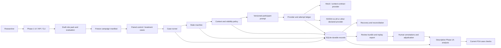

# AGORA Phase 1 — Current Implementation Status After PR #6 and PR #7

**As-of date:** 2026-09-10  
**Repository:** `criticaldata/agoraworkshop`  
**Audited source head:** `07748f205b9be0187e38d0886e1eb965b1165590`  
**Audited source branch:** `codex/phase1a-correctness-security-fixes`  
**Documentation branch:** `docs/phase1-current-implementation-status`  
**Scope:** status accounting and evidence review only; no application code is changed by this document.  
**Primary conclusion:** Phase 1A has a substantial and testable engineering implementation, but it is not yet a scientifically closed or confirmatory behavioral experiment.

## How to read this report

This report keeps three claims separate:

1. **Implemented** means that code, storage, interfaces, or tests exist in the audited checkout.
2. **Technically verified** means that the implementation was exercised by the current automated suite, build, or mock validation campaign.
3. **Scientifically validated** means that the roles, estimand, review protocol, live campaign, and analysis have been frozen and executed with adequate evidence. That claim is not established merely by compiling or passing unit tests.

The status vocabulary is:

| Status | Meaning |
|---|---|
| `COMPLETE` | The requested engineering component exists and its current contract is testable. |
| `PARTIAL` | A usable component exists, but the stated target or evidence contract is incomplete. |
| `DOCUMENTATION_ONLY` | The item is specified or described, but no corresponding implementation or run evidence is present. |
| `NOT_IMPLEMENTED` | No implementation exists in the audited Phase 1 scope. |
| `READY` | Ready for the stated activity without a material unresolved prerequisite. |
| `READY_WITH_CONDITIONS` | Technically usable, but gated by explicit protocol, review, provenance, or evidence conditions. |
| `NOT_READY` | The activity should not be treated as completed or used for the stronger claim. |

## 1. Executive summary

| Area | Current verdict | What the evidence supports |
|---|---|---|
| Phase 0 inherited instrument | `COMPLETE` under the current mock validation path | Routing, persistence, visibility, retries, failure attribution, exports, and replay are implemented and the fresh mock validation passed the core gates. |
| Phase 1A campaign engineering | `COMPLETE` for the implemented scope | Versioned role packs, paired control/treatment cases, deterministic rotation, frozen hashes, execution, usage accounting, recovery links, review records, and exports exist. |
| PR #6 | `MERGED` | The role-experiment implementation and review workflow are on `master` through merge commit `7f0cd4d`. |
| PR #7 | `OPEN` and `MERGEABLE` at audit time | The four correctness, privacy, and measurement fixes are present on the PR #7 head, but are not yet on `master`. |
| Role and rubric definition | `READY_WITH_CONDITIONS` | A functional five-role starter and a two-question evaluation contract exist, but they remain explicitly draft proposals and require team/domain approval before a scientific campaign. |
| Mock/oracle calibration | `READY_WITH_CONDITIONS` | The deterministic and context-contract providers can verify plumbing, prompt/context receipts, and failure handling. They do not demonstrate role adherence, social cognition, persuasion, or deliberation. |
| Live behavioral Phase 1A campaign | `NOT_READY` | No live Phase 1A behavioral campaign, live role calibration, human annotation set, or completed scientific analysis is present in the audited checkout. |
| Phase 1A confirmatory claims | `NOT_READY` | The repository has descriptive analysis and P1A runtime checks, not an approved confirmatory estimand, power plan, aggregate release gates, and live evidence. |
| Phase 1B capability treatment | `NOT_IMPLEMENTED` | There is no Phase 1B schema, capability treatment, retrieval corpus, tool experiment, or Phase 1B run. |

**Bottom line:** the repository is in a good position for controlled calibration and continued Phase 1A engineering review. It is not correct to present the current state as evidence that differentiated agents behaved differently, formed coalitions, reached consensus, or influenced one another.

## 2. Git lineage and exact PR state

The two PRs are logically stacked, but they do not have the same Git status:

| Item | Exact current fact |
|---|---|
| Repository | `https://github.com/criticaldata/agoraworkshop` |
| PR #6 | [Phase 1A: role experiment specification and implementation](https://github.com/criticaldata/agoraworkshop/pull/6) |
| PR #6 state | `MERGED` into `master` |
| PR #6 base at creation | `master` at `5fd5f6c53372d974836dc34e4852d8eb799ad06b` |
| PR #6 head | `codex/phase1a-role-experiments` at `27304a004eea25203a0fe28c92bad537f689a21a` |
| PR #6 merge commit | `7f0cd4d2d3bc972b5244294c98faacc87e3a46cb` |
| PR #6 change size | 2 commits; 35 files changed; +2111/-15 |
| PR #7 | [Phase 1A: correctness, privacy, and measurement fixes](https://github.com/criticaldata/agoraworkshop/pull/7) |
| PR #7 state | `OPEN`, non-draft, `MERGEABLE`, `CLEAN` at audit time |
| PR #7 base ref | `codex/phase1a-role-experiments` at `27304a004eea25203a0fe28c92bad537f689a21a` |
| PR #7 head | `codex/phase1a-correctness-security-fixes` at `07748f205b9be0187e38d0886e1eb965b1165590` |
| PR #7 change size | 1 commit; 8 files changed; +165/-14 |
| PR #7 remote check | `AGORA Phase 0 / verify` completed successfully on the observed PR checks |
| Current `origin/master` | `7f0cd4d2d3bc972b5244294c98faacc87e3a46cb`; contains PR #6, not PR #7 |

The audited implementation state in this report is therefore the combined state visible at the PR #7 head. It should not be described as the current default-branch state until PR #7 is merged. The documentation branch is based on that PR #7 head and does not modify either source branch.

### Lineage diagram

```text
master @ 5fd5f6c
    |
    +-- PR #6 head 27304a0
    |       |
    |       +-- merge commit 7f0cd4d on master
    |
    +-- stacked PR #7 base 27304a0
            |
            +-- PR #7 head 07748f2
                    |
                    +-- documentation branch for this report
```

## 3. Phase 0 baseline and inherited apparatus

Phase 1A is an additive layer over the Phase 0/0.1 instrument. The inherited apparatus is not being replaced by the role experiment.

| Inherited component | Current implementation | Status and boundary |
|---|---|---|
| Runner and state machine | TypeScript runner with ordered workshop states, durable transitions, sequential turns, budgets, retries, and recovery hooks | `COMPLETE` for the implemented Phase 0 contract; the Phase 1 eight-stage scientific target is a separate comparison below. |
| Provider boundary | Registry includes `openai`, `anthropic`, `mock`, `mock_context_contract`, and `nvidia_vllm` | `COMPLETE` as a parametric boundary; no Phase 1 live behavioral run is implied by provider availability. |
| Mock provider | Deterministic stand-in based on agent/context inputs | `COMPLETE` for infrastructure tests; not a role-adherence or social-behavior simulator. |
| Context assembly | Public, private, breakout, moderator, and participant visibility policies; optional deterministic summaries with source IDs and hashes | `COMPLETE` as an auditable infrastructure path; summaries are extractive rather than semantic. |
| Privacy routing | Scope-aware context construction and privacy audit | `COMPLETE` on tested paths; generic raw run-read endpoints still require `AGORA_AUTH_SCOPE=all` when private transcripts must be protected from public reading. |
| Events and state transitions | Durable event log, contiguous sequence checks, explicit transition records | `COMPLETE` for the inherited apparatus. |
| Opportunities | Response opportunities have IDs, scopes, agent/phase information, terminal status, and traces | `COMPLETE`; Phase 1 links cases and runs to these records. |
| Invocations and retries | Invocation ledger, attempt records, retry events, provider outcomes, token usage and failure category | `COMPLETE`; PR #7 also corrected how infrastructure failures affect P1A delivery checks. |
| Failure attribution | Explicit behavioral outcomes versus infrastructure failures | `COMPLETE` for the Phase 0 contract and reused by Phase 1. |
| Persistence | SQLite schema for runs, events, messages, invocations, summaries, tools, checkpoints, artifacts, and semantic records | `COMPLETE` as the storage layer. |
| Configuration identity | Effective configuration and fixed-settings hashes | `COMPLETE`; Phase 1 additionally requires distinct full control/treatment hashes and equal fixed hashes. |
| Provenance | Provider/model/config/prompt and artifact hashes are carried through the run/bundle contracts | `COMPLETE` as an audit mechanism; it does not prove a scientific result. |
| Export and replay | Phase 0 bundle contract, JSON/JSONL exports, trace index, acceptance report, and replay HTML | `COMPLETE` for the implemented contract. |
| Acceptance | M1-M22 core metrics and Gates 1-3 | `COMPLETE` on the fresh default mock validation described in Section 26. |
| Phase 0.1 extension | M23-M30 implementations and dedicated configurations exist, including context, tool, recovery, backup, moderator, and live-canary paths | `PARTIAL` as a current default validation claim: these checks are opt-in and must be linked to the appropriate supporting runs. |

### Fresh Phase 0 mock validation boundary

The fresh `npm run agora -- validate` execution on the audited source head used the deterministic mock provider. It is evidence about the instrument, not about Phase 1A role behavior. Its reported evidence included:

- 273 events with contiguous sequencing;
- 25 opportunities and 25 invocation provenance links;
- 20 public participant messages and 5 private messages;
- 108 deliveries;
- 24 generated artifacts against 23 required bundle files;
- 0 privacy leaks across 272 audited context references;
- 6 state transitions;
- 6 classified infrastructure events, 5 retries, 3 opportunities succeeding on a later attempt, 1 exhausted retry, and 30 attempts across the configured agents;
- two completed same-configuration runs for the reproducibility gate; and
- Gates 1, 2, and 3 reported as `PASS` for that mock package.

The default validation path is not a Phase 1A behavioral campaign. M23-M30 are implemented as opt-in robustness checks and are not automatically evidence for every Phase 1A run.

The exact fresh validation identifiers were:

| Evidence item | Value |
|---|---|
| Baseline run | `run_919ed913-b7ea-4699-8626-acdaacb796ae` |
| Exact-config rerun | `run_3ac89ba3-3286-41fc-9c93-b012e23dd7ec` |
| Fault run | `run_c9e846af-7315-48af-a3ed-a96ee3f879df` |
| Baseline/rerun config hash | `sha256:9aec2b3420a41a0d97835c3815cc8702b899c25bb5de2fac6e8bf4da1c57be5c` |
| Fault config hash | `sha256:bdc1df6f6136d364092f162dd1affceacefde6f22db2af0ec0c0b0de417a24ef` |
| Provider/model | `mock` / `mock-deterministic-v1` |
| Live canary link | `null` |

## 4. What PR #6 implemented

The following accounting uses `COMPLETE`, `PARTIAL`, `DOCUMENTATION_ONLY`, and `NOT_IMPLEMENTED` for the engineering scope of PR #6.

| PR #6 area | Status | Current implementation and limitation |
|---|---|---|
| Optional Phase 1 configuration contract | `COMPLETE` | `phase1` is opt-in, versioned, and validated separately from legacy Phase 0 configurations. |
| Phase 1A prompt version | `COMPLETE` | `phase1a-v1` composes common framing with the identity's assigned role only; control target roles remain evaluator-only. |
| Immutable role-pack snapshots | `COMPLETE` | Draft revisions, exact role text, content hashes, and frozen campaign identity are persisted. |
| Control/treatment pairing | `COMPLETE` | Neutral-control and differentiated-role cases are generated as paired cases with structural comparability checks. |
| Role allocation | `COMPLETE` | Cyclic allocation rotates roles across identities and blocks; it is deterministic, not random, and not a power calculation. |
| AB/BA execution order | `COMPLETE` | Odd blocks reverse pair order to balance order exposure over the ten-block starter plan. |
| Fixed-setting comparison | `COMPLETE` | Full hashes differ because the condition/role fields differ; the fixed-settings fingerprint must match. |
| Sequential workshop execution | `COMPLETE` | Planned cases run through the existing provider, context, retry, budget, trace, persistence, and recovery paths. |
| Independent condition histories | `COMPLETE` | Control and treatment cases do not share dialogue history; the comparison is not a same-transcript counterfactual. |
| Partial/unstarted case retention | `COMPLETE` | Durable case/run links retain pending and partial cases rather than dropping them from denominators. |
| Campaign usage ledger | `COMPLETE` | Provider attempts are recorded with hard admission checks for calls and tokens; unknown usage blocks further calls. |
| Researcher UI/API/CLI | `COMPLETE` | Draft, preview, freeze, execute, show, annotate, evidence-link, and export operations are exposed through `/phase1`, `/api/phase1`, and `agora phase1`. |
| Position probes | `COMPLETE` as an instrument | Versioned two-question probes, private records, and exact status handling exist; scientific interpretation remains draft. |
| Behavioral analysis | `COMPLETE` as descriptive infrastructure | Participation, response relations, role-fidelity inputs, position changes, inequality, and reviewer-defined uptake are represented with missingness. |
| Human annotation storage | `COMPLETE` as workflow infrastructure | Exact quotes, source/target IDs, rubric/version, reviewer identity, revisions, and adjudication links are stored. No completed reviewer dataset is evidence here. |
| Review bundle | `COMPLETE` as export code | Canonical JSON review bundles include plans, prompts, raw records, semantic artifacts, labels, usage, evidence links, and hashes. |
| Explicit eight-stage state machine | `PARTIAL` | The current runtime has five nonzero workshop states plus probes and closing; S4/S5 are collapsed into `FINAL_DISCUSSION`. |
| Collective outcome | `NOT_IMPLEMENTED` | No ballot, vote, aggregation, consensus, or majority/minority output is implemented. |
| Structured final output | `NOT_IMPLEMENTED` | Closing text is free-form; there is no schema-bound collective artifact. |
| P1-A/P1-B/P1-C/P1-D aggregate release gates | `NOT_IMPLEMENTED` | Current code exposes case-level `P1A-*` checks, not the target aggregate gate family. |
| Approved scientific protocol | `DOCUMENTATION_ONLY` | The implementation specification and behavioral protocol explicitly mark roles, rubric, questionnaire, estimand, sample size, provider, and other choices as pending or draft. |
| Phase 1B capability experiment | `NOT_IMPLEMENTED` | Phase 1A actively rejects tools and capability manifests; Phase 1B remains a documented extension. |

### What PR #6 does not establish

PR #6 does not establish that a role is psychologically internalized, that an agent has a stable personality, that a message is persuasive, that an interaction is human-like, or that a group reached consensus. It builds an apparatus for collecting and reviewing such observations under controlled conditions; the observations still require a frozen protocol and executed campaign.

## 5. What PR #7 corrected

PR #7 contains four targeted corrections. These are implemented at the PR #7 head and covered by the current test suite.

| Correction | Status | Effect |
|---|---|---|
| P1A delivery semantics | `COMPLETE` | `P1A-DELIVERY` now fails on infrastructure failures, unknown outcomes, or non-null failure categories. Valid `success`, `explicit_abstention`, and `no_op` outcomes pass. A missing call is `NOT_EXERCISED`. |
| Private review authentication | `COMPLETE` with a remaining scope condition | Review HTML and annotation API paths now require authentication even under the default write scope. Generic raw run reads are still governed by instance scope; use `AGORA_AUTH_SCOPE=all` when private transcripts must not be publicly readable. |
| Interaction denominators | `COMPLETE` | Direct response and interaction-contingency eligibility is participant-only, excludes introduction messages, excludes moderator targets, and requires actual exposure of an earlier peer message. |
| Position-probe statuses | `COMPLETE` | Raw persistence distinguishes `pending`, `valid`, `invalid`, and `missing`; external analysis distinguishes `NOT_EXERCISED`, `EXECUTED_BUT_INVALID`, `EXECUTED_BUT_MISSING`, and `VALID`. |

The corrections reduce false positive measurement states. They do not create a live campaign, a completed human review, or an aggregate scientific release gate.

## 6. Current architecture



The architecture separates the intervention layer (role assignment and prompt composition) from the inherited instrument layer (routing, context, provider calls, failure attribution, persistence, recovery, and export). The current tool gateway is an allow-listed deterministic echo/probe boundary for Phase 0.1 infrastructure; Phase 1A configuration validation rejects tool capability treatments.

## 7. Actual runtime flow versus the target eight-stage flow

### Actual current runtime flow

The current runner executes the following sequence when evaluation is enabled:

1. Collect an initial position probe before workshop phases. The initial context is empty and the assessment answer is not routed into the workshop.
2. Transition through `INTRODUCTION` and run the moderator/participant turns.
3. Run `PUBLIC_DISCUSSION` with deterministic speaking order.
4. Run `PRIVATE_OR_BREAKOUT` with the configured private or breakout visibility.
5. Run `FINAL_DISCUSSION` publicly.
6. Collect the final position probe after participant deliberation and before closing.
7. Transition to `CLOSING`, run the scripted or LLM moderator close, and complete if no opportunities remain unresolved.

The state machine itself is:

```text
INTRODUCTION -> PUBLIC_DISCUSSION -> PRIVATE_OR_BREAKOUT -> FINAL_DISCUSSION -> CLOSING -> COMPLETED
```

There is no separate state or transition for every scientific stage below. The report deliberately does not treat a line of moderator text as an implemented state.

### Mapping to the target eight stages

| Target stage | Scientific label | Current representation | Status |
|---|---|---|---|
| S1 | Independent initial position | Optional initial probe before the moderator opening | `PARTIAL` and conditional on evaluation being enabled |
| S2 | Public plenary I | Introduction plus `PUBLIC_DISCUSSION`; no distinct S2 label | `PARTIAL` |
| S3 | Private rooms | `PRIVATE_OR_BREAKOUT` with static configured scope and sequential turns | `COMPLETE` when configured |
| S4 | Public reconvening | Opening line inside `FINAL_DISCUSSION`; no separate reconvening transition | `PARTIAL` |
| S5 | Public plenary II | Same `FINAL_DISCUSSION` state as S4 | `PARTIAL` |
| S6 | Independent final position | Optional final probe before closing | `PARTIAL` and conditional on evaluation being enabled |
| S7 | Collective outcome | No ballot, vote, group decision, or aggregate outcome record | `NOT_IMPLEMENTED` |
| S8 | Structured final output | Free-form closing text; no schema-bound final group artifact | `NOT_IMPLEMENTED` |

### Why the distinction matters

The target stages represent different scientific opportunities to observe independent positions, public interaction, private interaction, reconvening, change, and collective production. Collapsing stages can be acceptable as an engineering prototype, but it changes what can be claimed. The current code supports a bounded sequential workshop with probes; it does not yet implement the complete eight-stage protocol as a state-labeled, gate-checked experiment.

## 8. Scientific role of the eight stages

| Stage | Scientific purpose | What can be learned if validly executed | What is not inferred automatically |
|---|---|---|---|
| S1 | Establish an independent pre-deliberation reference | Each participant's expressed starting position and confidence | A latent belief, stable preference, or internal mental state |
| S2 | Observe public exposure and early responses | Who had an opportunity to respond and which peer messages were exposed | Persuasion, agreement, or causality from message order alone |
| S3 | Test whether private context changes what is later available publicly | Scope-specific participation, exposure, and later uptake candidates | Hidden agreement, coalition, or private intention |
| S4 | Mark the transition from private interaction back to the group | Whether later public turns occur after reconvening and which sources are authorized | That reconvening created a social effect |
| S5 | Observe later public interaction under the same declared condition | Direct replies, contingent responses, revisions, challenges, support, and uptake labels | Human-like deliberation or consensus |
| S6 | Establish an independent post-deliberation reference | Expressed change and confidence shift relative to S1 | That the workshop caused the change without an analysis plan and suitable controls |
| S7 | Capture a collective decision or outcome, if the protocol elects to include one | A structured group-level result with explicit participation rules | Consensus from a free-form moderator sentence |
| S8 | Capture a constrained final artifact | Quality or completeness against a frozen rubric, if reviewed | Scientific quality or agreement without human/approved evaluation |

## 9. Exact current role system

### Functional starter pack

The current starter is a proposed functional role pack, not an approved behavioral taxonomy:

- role-pack ID: `reimagining-humans-functional`;
- version: `functional-draft-1`;
- title: `Functional roles (proposed)`;
- status: draft;
- five participant identities and one moderator;
- role text is assigned only to the target identity in the treatment condition;
- the control receives the common neutral instruction; its corresponding target role is retained for evaluator-only scoring and is not exposed to the control agent.

| Role ID | Display title | Operational purpose |
|---|---|---|
| `proposer` | Proposal developer | Develop concrete alternatives and make the proposal actionable. |
| `critic` | Critical evaluator | Identify assumptions, weaknesses, counterarguments, and failure modes. |
| `evidence` | Evidence assessor | Distinguish evidence, uncertainty, unsupported claims, and what would resolve uncertainty. |
| `integrator` | Argument integrator | Connect compatible contributions, identify tensions, and make the structure of the argument explicit. |
| `consequences` | Consequence and feasibility assessor | Examine implementation consequences, constraints, trade-offs, and feasibility. |

The exact instructions and criterion weights are in `src/phase1/evaluationContract.ts`. The role pack is intentionally marked draft because a domain owner still has to approve wording, overlap, role disclosure, scoring criteria, and the interpretation of role fidelity.

### Legacy starter pack

The implementation also retains the earlier disciplinary-perspective pack for compatibility with frozen campaigns: `analytic`, `plural`, `clinical`, `design`, and `ecological`. It must not be silently described as the functional intervention. A campaign's frozen role-pack ID, version, exact text, and hash determine which system was actually used.

### Moderator

The starter campaign uses the deterministic scripted moderator by default. It emits fixed state-based framing and closing lines, makes no provider call, consumes no model tokens, and cannot change runtime state or decide who speaks. An LLM moderator is supported as a separate configuration, but it is not the same condition and should not be mixed into the first role-only comparison.

## 10. Experimental design and held constants

### Intervention

Phase 1A asks what differences appear when otherwise equivalent agents receive differentiated functional role instructions rather than the same neutral instruction. The role prompt is the treatment. The model, provider, tools, moderator policy, topic, schedule, context policy, and budgets are held constant within a comparison.

### Pair construction

| Design element | Current rule |
|---|---|
| Participants | Exactly five participant identities plus one moderator |
| Cases | One neutral control and one differentiated treatment case per block |
| Default starter blocks | Ten blocks; two complete cyclic role rotations |
| Role allocation | Target role for participant index `i` in block `b` is selected by `(i + b) mod 5` |
| Pair order | Odd block indexes reverse control/treatment order to alternate AB/BA |
| Randomization | None; allocation and order are deterministic and predeclared |
| Power | No power calculation is claimed by the ten-block starter |
| Histories | Control and treatment histories are independent, not shared |
| Hashes | Full control/treatment hashes differ; fixed-settings fingerprints must match |
| Prompt version | All participant calls use `phase1a-v1` |
| Tools | Disabled in Phase 1A by schema validation |
| Evaluation routing | Initial and final answers are stored privately and are not inserted into dialogue context |
| Missingness | Partial, unstarted, invalid, missing, and infrastructure-failed cases are retained and reported; missing review is not converted to zero |

### Constants that must be frozen before a live campaign

The implementation can carry these fields, but the team still has to freeze their values for a scientific run: final role text, role rubric and weights, questionnaire wording and options, moderator mode and opening, role-disclosure policy, model/provider and exact deployment, rounds and schedule, budget limits, context/summarization policy, missingness rules, primary estimand, review/adjudication procedure, and the number and unit of experimental cases.

## 11. Complete Phase 1A metric matrix

The following matrix answers “does the metric exist in the current implementation?” It does not convert a metric into a validated scientific result. `Complete` in this table means that the data path or computation exists; the readiness column captures whether it is ready for a live claim.

### 11.1 Experimental integrity

| Metric | Implementation | Current evidence/definition | Readiness |
|---|---|---|---|
| Valid Opportunity Rate | `PARTIAL` | Opportunity lifecycle and terminal counts exist, with scope-level infrastructure-adjusted rates; no named Phase 1 aggregate is emitted. | `READY_WITH_CONDITIONS` |
| Context Parity | `PARTIAL` | Structural comparison validates fixed settings, prompt version, model/tools/topic/budgets and fixed hash. Exact dialogue histories are intentionally independent, so “same context history” is not the metric. | `READY_WITH_CONDITIONS` |
| Infrastructure-Adjusted Response Rate | `COMPLETE` | Case scope measures successful participant messages against eligible opportunities while separating infrastructure failures. | `READY_WITH_CONDITIONS` |
| Configuration/prompt integrity | `COMPLETE` | Frozen manifest, exact prompt resolution, full hashes, and fixed-settings fingerprint are persisted and checked. | `READY_WITH_CONDITIONS` |
| Privacy/context authorization | `COMPLETE` | Visibility and probe-context checks compare authorized source IDs and detect leaks; generic raw run reads need the correct instance auth scope. | `READY_WITH_CONDITIONS` |

### 11.2 Participation

| Metric | Implementation | Current evidence/definition | Readiness |
|---|---|---|---|
| Participation Share | `COMPLETE` | Participant successful-message count divided by all participant successful-message count in the declared scope; moderator is excluded. | `READY_WITH_CONDITIONS` |
| Turn Count | `COMPLETE` | Messages and opportunities are countable by agent, phase/state, channel, and case. | `READY_WITH_CONDITIONS` |
| Token Share | `PARTIAL` | Raw reported input/output tokens are retained where the provider reports them; no normalized token-share aggregate is emitted. Character share is not a token metric. | `READY_WITH_CONDITIONS` |
| Gini | `COMPLETE` | Descriptive participation inequality is computed in `participation_inequality.gini`. | `READY_WITH_CONDITIONS` |
| Entropy | `COMPLETE` | Normalized participation entropy is computed in `participation_inequality.normalized_entropy`. | `READY_WITH_CONDITIONS` |

### 11.3 Interaction

| Metric | Implementation | Current evidence/definition | Readiness |
|---|---|---|---|
| Direct Response Rate | `COMPLETE` | Human `direct_reply` annotations identify a participant response to an earlier eligible peer message with actual exposure. | `READY_WITH_CONDITIONS` |
| Challenge Rate | `PARTIAL` | `challenges` can be stored as a human-labeled relation, but no standalone challenge-rate aggregate is emitted. | `NOT_READY` for a named aggregate |
| Support Rate | `PARTIAL` | `supports` can be stored as a human-labeled relation, but no standalone support-rate aggregate is emitted. | `NOT_READY` for a named aggregate |
| Revision Rate | `PARTIAL` | `revises` can be stored as a relation, but no standalone revision-rate aggregate is emitted. | `NOT_READY` for a named aggregate |
| Interaction Contingency Rate (ICR) | `COMPLETE` as an assessed measure | Eligible participant messages require an earlier exposed peer message; moderator messages, initial messages, and parallel monologues are excluded from the denominator. | `READY_WITH_CONDITIONS` |
| Argument Uptake | `COMPLETE` as reviewer-defined inventory | Later reuse of an introduced idea can be recorded with exact source/target evidence and exposure. The inventory is non-exhaustive and not an automated causal measure. | `READY_WITH_CONDITIONS` |

### 11.4 Role adherence, influence, and change

| Metric | Implementation | Current evidence/definition | Readiness |
|---|---|---|---|
| Role Fidelity | `COMPLETE` as annotation infrastructure | Reviewer criteria are weighted, scored 0-2, tied to exact messages and target roles, and reported per reviewer. Missing review is not zero; no pooled reviewer score or inter-rater reliability is currently calculated. | `READY_WITH_CONDITIONS` after rubric/reviewer approval |
| Response Centrality | `COMPLETE` as assessed-only association | Computed from assessed response edges; it is descriptive association, not causal influence. | `READY_WITH_CONDITIONS` |
| Initial-Final Position Change | `COMPLETE` when evaluation is enabled | Per-question and run-level change are computed only when valid initial/final pairs exist; incomplete pairs are null or incomplete, not fabricated. | `READY_WITH_CONDITIONS` |
| Confidence Shift | `COMPLETE` per question | Final confidence minus initial confidence is available with the questionnaire record. It is not a calibrated latent confidence estimate. | `READY_WITH_CONDITIONS` |
| Preference Switching | `PARTIAL` | A `switched` field exists per question and contributes to position-change analysis; no separate named aggregate is released. | `READY_WITH_CONDITIONS` |

### 11.5 Private/public and group outcomes

| Metric | Implementation | Current evidence/definition | Readiness |
|---|---|---|---|
| Private-to-Public Uptake | `NOT_IMPLEMENTED` | No dedicated aggregate identifies private ideas later reused publicly. Reviewer evidence can support future implementation. | `NOT_READY` |
| Public-Private Divergence | `PARTIAL` | Annotation categories can describe divergence; no aggregate metric is emitted. | `NOT_READY` for a named aggregate |
| Interaction Modularity | `NOT_IMPLEMENTED` | No community/modularity calculation is implemented. | `NOT_READY` |
| Private Contact Density | `NOT_IMPLEMENTED` | No private contact-density aggregate is implemented. | `NOT_READY` |
| Coalition Persistence | `NOT_IMPLEMENTED` | No coalition definition, membership rule, or persistence estimator exists. | `NOT_READY` |
| Voting Alignment | `NOT_IMPLEMENTED` | No vote or ballot instrument exists. | `NOT_READY` |
| Consensus Rate | `NOT_IMPLEMENTED` | No approved consensus definition or group aggregation exists. | `NOT_READY` |
| Majority/minority structure | `NOT_IMPLEMENTED` | No majority/minority decision record exists. | `NOT_READY` |
| Minority Preservation | `NOT_IMPLEMENTED` | No outcome or preservation rule exists. | `NOT_READY` |
| Time/Turns to Decision | `NOT_IMPLEMENTED` | No decision event exists from which this metric could be defined. | `NOT_READY` |
| Final Output Quality | `NOT_IMPLEMENTED` | Scripted moderation is not a quality instrument; the LLM closing is free-form and unreviewed. | `NOT_READY` |

### 11.6 Operational measures

| Metric | Implementation | Current evidence/definition | Readiness |
|---|---|---|---|
| Latency | `COMPLETE` | Invocation timestamps and per-attempt timing are retained. | `READY_WITH_CONDITIONS` |
| Retries | `COMPLETE` | Attempts and retry events are retained and linked to the opportunity trace. | `READY_WITH_CONDITIONS` |
| Tokens | `COMPLETE` as raw accounting | Reported input/output tokens and campaign ledger values are retained with missingness. | `READY_WITH_CONDITIONS` |
| Cost | `NOT_IMPLEMENTED` | `estimated_cost` remains null; token counts are not a cost estimate. | `NOT_READY` |
| Throughput | `PARTIAL` | Duration and counts exist, but no named normalized throughput aggregate is emitted. | `NOT_READY` for a release metric |

### Matrix interpretation

The matrix supports a controlled measurement plan, not a claim that the agents already demonstrate the measured phenomena. In particular, response volume is not influence, a labeled response edge is not persuasion, a position switch is not proof of persuasion, and role-fidelity score is not evidence of an internal personality.

## 12. Role Fidelity

Role Fidelity is the primary instrument for checking whether generated messages express the assigned functional role. It is not an automatic personality detector.

### Current scoring contract

- Each treatment participant has a target role and role-specific criteria.
- Each criterion is weighted and scored by a human reviewer from 0 to 2, or marked not assessable.
- The reviewer records the exact source message ID, target role, quoted evidence, reason, rubric version, reviewer identity, and annotation status.
- The normalized assessed mean divides the score by the maximum score and assessed message count, then combines criteria by their positive weights.
- A complete per-reviewer value requires all eligible messages for every criterion to have an assessment. The assessed-only value remains separate.
- Control participants retain evaluator-only target roles so that the target perspective can be evaluated without exposing the treatment instruction.
- Annotation revisions use `supersedes` and `adjudicates` links. Conflicts are not silently averaged.

### Current limitations

There is no completed human reviewer dataset in this status report, no inter-rater reliability calculation, no approved role rubric, and no automated classifier accepted as a substitute for human review. Therefore the role-fidelity code is implemented, but its scientific result is unavailable until the review protocol is frozen and executed.

## 13. Interaction Contingency Rate after PR #7

ICR is intended to distinguish a message that responds to an exposed peer message from a message that merely occurs later in the schedule.

The current eligibility logic:

1. includes participant messages only;
2. excludes `INTRODUCTION` messages and initial probe records;
3. requires an earlier message from another participant to have been present in the actual invocation context;
4. excludes moderator targets and moderator-only context;
5. requires a positive or negative human relation label for an assessed value; and
6. preserves eligible, assessed, missing, not-assessable, and complete counts separately.

The positive relations can distinguish direct response, challenge, support, revision, and uptake when a reviewer supplies the exact target ID/quote and exposure evidence. This is stronger than counting adjacent turns, but it still establishes an evidence-linked interaction classification rather than human interpretation truth or causality.

## 14. Current P1A checks versus target aggregate gates

### Checks that currently exist

`campaignAnalysis()` exposes case-level checks including:

- `P1A-FROZEN`: frozen manifest hash and integrity;
- `P1A-COMPARABLE`: declared control/treatment structural comparison;
- `P1A-COMPLETED`: case completion condition;
- `P1A-PROMPTS`: participant prompts match the frozen resolver;
- `P1A-VISIBILITY`: privacy audit has no violations;
- `P1A-DELIVERY`: after PR #7, no infrastructure failure or unknown outcome contaminates the behavioral delivery check;
- `P1A-POSITIONS`: exact status of valid, invalid, missing, or unexercised position probes; and
- `P1A-PROBE-CONTEXT`: initial and final probe contexts satisfy the authorized-source contract.

The runtime also distinguishes `engineering_verified`, `live_executed`, `human_annotated`, and `scientific_analysis_completed`. On the current implementation path, `engineering_verified` is not automatically turned into true by running a campaign, and `scientific_analysis_completed` remains false until an agreed analysis is completed.

### Target aggregate gate status

The repository does not implement aggregate release gates named `P1-A`, `P1-B`, `P1-C`, and `P1-D`. The following mapping is a planning proposal only, not the current contract:

| Target gate | Proposed purpose | Current status |
|---|---|---|
| `P1-A` | Instrument and execution integrity | No aggregate implementation; current case checks are the building blocks. |
| `P1-B` | Treatment/prompt comparability and role-manipulation integrity | No aggregate implementation; frozen/comparable checks exist per campaign/case. |
| `P1-C` | Behavioral measurement completeness and review validity | No aggregate implementation; metric and annotation infrastructure exists. |
| `P1-D` | Scientific analysis/release readiness | No aggregate implementation; no approved estimand, completed live analysis, or claim certificate. |

These gate names and acceptance criteria must be frozen by the team before they can be used in a closure claim. Current `P1A-*` checks must not be renamed into aggregate gates without defining denominators, missingness, required evidence, and failure behavior.

## 15. Readiness verdicts

| Readiness question | Verdict | Rationale |
|---|---|---|
| Is the Phase 1A engineering layer present? | `READY_WITH_CONDITIONS` | The implementation and current tests are substantial, but PR #7 is still open and the report is based on the PR branch rather than `master`. |
| Can the team run mock calibration? | `READY_WITH_CONDITIONS` | Mock providers, context-contract receipts, deterministic rotation, and exports are available. Calibration must be described as plumbing/context validation, not cognitive validation. |
| Can the team claim role adherence from the mock? | `NOT_READY` | The mocks do not simulate semantic role adherence and there is no human review dataset. |
| Can the team run a live behavioral role campaign now? | `NOT_READY` | Roles, rubric, estimand, sample size, model/provider, and analysis plan remain draft or pending; no live Phase 1A campaign is evidenced. |
| Can the team make confirmatory behavioral claims? | `NOT_READY` | No approved aggregate gates, completed human review/adjudication, or scientific analysis is present. |
| Is Phase 1B available? | `NOT_IMPLEMENTED` | The code and schema intentionally block capability treatment in Phase 1A and contain no Phase 1B implementation. |

## 16. Remaining Phase 1A closure backlog by stage

| Stage or closure area | Remaining work | Why it matters |
|---|---|---|
| Governance before S1 | Approve/freeze the protocol, five role prompts, rubric, questionnaire, estimand, missingness rules, reviewer/adjudication process, sample/unit, moderator policy, and exact provider/model. | A draft implementation is not an approved experiment. |
| S1 initial probe | Execute valid initial assessments for the frozen live campaign and retain private evidence. | Establishes a comparable pre-deliberation reference. |
| S2 public plenary I | Decide whether introduction and the first public discussion are one stage or implement explicit S2 labels/transitions. | Stage labels determine exposure and denominator interpretation. |
| S3 private rooms | Freeze breakout membership, scope, and moderator visibility; verify private-to-public evidence policy. | Private interaction is only interpretable if authorization and exposure are explicit. |
| S4 reconvening | Add an explicit reconvening state/event if S4 is part of the approved protocol. | A moderator sentence alone is not a state transition. |
| S5 public plenary II | Separate or formally define the post-reconvening discussion window. | Needed to identify later public responses and uptake windows. |
| S6 final probe | Execute valid final assessments before closing and link each to the actual authorized context. | Enables initial-final change and confidence-shift measures. |
| S7 collective outcome | Decide whether a ballot, decision, or group artifact is truly in scope; implement a schema and acceptance contract only if approved. | No current code supports consensus/voting/majority claims. |
| S8 structured output | Define a schema and review rubric for any final group artifact, or explicitly remove S8 from the protocol. | Free-form closing text cannot support a structured-outcome claim. |
| Human review | Complete role-fidelity and interaction annotations, revisions, and adjudication under the frozen rubric. | Machine records alone cannot supply semantic role or relation judgments. |
| Aggregate gates | Define and implement P1-A through P1-D with denominators, evidence requirements, and blocking rules. | Current case checks do not constitute a release certificate. |
| Live evidence | Run baseline/control, treatment, and any planned replication/fault/support packages with the declared provider; export and hash every package. | Mock validation cannot substitute for live behavioral evidence. |
| Release review | Merge PR #7 after review, update any branch-targeting issues, and publish the final status/bundle references. | The combined implementation is not yet the default-branch release. |
| Documentation cleanup | Correct or clearly label any README example that names the separate `leoclaw-qwen3-32b` service or port `18002`; do not treat it as AGORA evidence. | Prevents provider provenance confusion. |

## 17. Phase 1B current state

Phase 1B is explicitly out of scope for the current implementation. No `phase1b` schema, enum, config, capability registry, tool treatment, retrieval corpus, capability-specific UI, capability analysis, or Phase 1B test suite exists.

This is an intentional boundary, not a missing switch. Phase 1A validation rejects:

- `tools_enabled=true`;
- a non-empty capability manifest; and
- tool probes in a Phase 1A configuration.

The reusable foundation for Phase 1B already exists: campaign freezing, case pairing, prompt/config hashes, provider/context/visibility controls, retry and budget accounting, trace-linked records, SQLite persistence, exports, review annotations, and descriptive analysis.

## 18. Proposed Phase 1B C0/C1 frozen retrieval contract

The following is a recommended contract for a future Phase 1B PR. It is not implemented or approved by this report.

| Element | C0 control | C1 capability treatment |
|---|---|---|
| Capability | Retrieval unavailable | The same bounded retrieval capability is available through an allow-listed gateway |
| Model/role/moderator | Identical and frozen | Identical and frozen |
| Topic/schedule/budget | Identical and frozen | Identical and frozen |
| Corpus | Same frozen corpus version/hash declared in both cases | Same frozen corpus version/hash declared in both cases |
| Tool schema | No callable retrieval action | Exact versioned retrieval schema and authorization policy |
| Results | No capability result | Result includes query, selected record IDs, corpus version, result hash, latency, and visibility scope |
| Action loop | No tool opportunity | Bounded action count, timeout, retry, invalid-result, unavailable, and permission-fault behavior |
| Provenance | Capability-unavailable decision recorded | Every opportunity, invocation, result, failure, and later use linked to the case trace |
| Scientific interpretation | Non-use is not observed because the capability is unavailable | Available-but-unused, attempted, successful, and later-used are distinct states |

A frozen local corpus and deterministic bounded retrieval are recommended for the first capability experiment. Open-web retrieval should not be the first C1 condition because corpus drift, latency, access failures, and result ranking would introduce uncontrolled changes.

## 19. Phase 1B engineering checklist

Before a Phase 1B campaign can be considered ready, the implementation would need:

1. A versioned Capability Registry with `capability_id`, version, manifest hash, schema, authorization, and result-visibility rules.
2. C0/C1 paired cases with capability allocation frozen before execution.
3. A versioned, frozen, hash-identified corpus and deterministic retrieval contract.
4. Tool opportunities, invocations, successful results, non-use, retries, failures, latency, and token/cost accounting.
5. Per-agent permission checks and private/public result isolation.
6. Evidence links from capability result to later message and reviewer-defined evidence uptake.
7. Configuration and prompt hashes that prove role/model/moderator constants.
8. Acceptance and export checks for unavailable, unused, successful, failed, and invalid capability states.
9. UI/API/CLI support for preview, freeze, execute, resume, annotate, and export.
10. Oracle and negative tests that make the capability contract fail when a result is unauthorized, untraceable, stale, or malformed.

## 20. Phase 1B metrics and experimental unit

The experimental unit should remain the run or predeclared paired block, not an individual message. Individual messages are nested observations and are not independent replicates.

| Metric | Definition for a future Phase 1B campaign |
|---|---|
| Tool Opportunity Rate | Capability opportunities available to the agent, with C0 and C1 denominators explicit. |
| Tool Adoption Rate | Invoked opportunities divided by capability opportunities; available-but-unused is behavioral non-use, not a provider failure. |
| Tool Success Rate | Successful capability results divided by invoked opportunities; timeout/unavailable/invalid result remain infrastructure outcomes. |
| Evidence Uptake | Reviewer-identified later use of a retrieved record, with exact source/result/message links. |
| Capability-adjusted latency | Invocation and result latency compared under the frozen budget and provider contract. |
| Failure burden | Rate and type of capability failures, retries, and exhausted opportunities. |
| Token/cost effect | Raw and normalized token/cost differences only if cost provenance is available. |
| Downstream interaction | Reuse, challenge, support, revision, and response measures under the same Phase 1A review rules. |
| Position change | Initial-final expressed position change, with valid pair and missingness rules unchanged. |

An available-but-unused tool is not the same as a timeout. A successful invocation is not the same as evidence uptake. These states must remain separate in both the ledger and the analysis.

## 21. Phase 1A closure definition

Phase 1A should be closed only through separate gates, not one undifferentiated “tests passed” statement:

| Closure layer | Minimum closure evidence | Current state |
|---|---|---|
| Engineering closure | Code review, merged PRs, build, full automated tests, configuration validation, and clean artifacts | `READY_WITH_CONDITIONS`; PR #7 is still open at the audited snapshot. |
| Instrument calibration | Mock/context-contract campaign, privacy and trace oracles, deterministic role allocation, valid probe statuses, and exported evidence | `READY_WITH_CONDITIONS`; the plumbing exists, but role semantics are not calibrated by mocks. |
| Live behavioral execution | Frozen protocol, declared provider/model, completed paired cases, valid initial/final probes, trace-linked bundles, and failure accounting | `NOT_READY`; no live Phase 1A behavioral campaign is evidenced. |
| Semantic review | Frozen reviewer rubric, completed annotations, revisions/adjudication, missingness report, and reviewer provenance | `NOT_READY`; workflow exists, completed review does not. |
| Scientific analysis | Approved estimand and analysis plan, case/run denominators, descriptive and uncertainty reporting, and explicit claim boundary | `NOT_READY`; descriptive code exists, but no approved confirmatory analysis is complete. |
| Release/claim closure | Aggregate gates pass, bundle is archived, protocol signoff is recorded, and conclusions stay within measured outcomes | `NOT_READY`. |

## 22. Phase 1B closure definition

Phase 1B should use the same separation:

1. **Implementation closure:** capability contract, registry, frozen corpus, authorization, failure matrix, accounting, UI/API/CLI, tests, and exports exist.
2. **Calibration closure:** C0/C1 oracle runs prove that unavailable, unused, successful, failed, invalid, private, and trace-linked states are distinguishable.
3. **Behavioral execution closure:** a frozen live capability campaign runs with complete paired evidence and valid missingness handling.
4. **Scientific analysis closure:** capability adoption, success, uptake, interaction, position, latency, and failure measures are analyzed with the run/block as the unit.
5. **Claim closure:** conclusions state null, positive, or mixed effects without interpreting capability use as intelligence, persuasion, or human-like agency.

Statistical significance is not a substitute for implementation or provenance closure. A null effect is a valid scientific result if the protocol and evidence support that interpretation.

## 23. Roadmap

| Order | Milestone | Exit condition |
|---|---|---|
| 0 | Protocol and role freeze | Team approves role text, rubric, questionnaire, estimand, missingness, moderator, provider, schedule, and unit. |
| 1 | PR #7 integration | Simon reviews the current head, branch targeting is resolved, and PR #7 is merged without losing the four fixes. |
| 2 | Phase 1A protocol-completion PR | Explicit stage contract and any approved S7/S8 artifacts are implemented, or removed from the approved protocol; aggregate P1-A through P1-D definitions are frozen. |
| 3 | Mock/oracle calibration | Deterministic and context-contract runs produce traceable exports and negative tests for every accepted condition. |
| 4 | Live Phase 1A campaign | Declared model/provider executes the frozen paired campaign with valid initial/final probes and complete bundles. |
| 5 | Human semantic review | Role-fidelity and interaction annotations are completed, revised, adjudicated, and exported. |
| 6 | Phase 1A analysis/release | Aggregate gates, denominators, missingness, limitations, and claim boundaries are approved. |
| 7 | Phase 1B design | Capability, corpus, C0/C1 contract, action loop, and Phase 1B estimands are approved. |
| 8 | Phase 1B implementation and calibration | Capability code and oracle evidence are complete before any live capability claims. |

## 24. Next PR recommendation (recommendation only; not implemented here)

The next engineering PR should be a **Phase 1A protocol-completion and aggregate-gates PR**, not a Phase 1B tools PR. Its scope should be narrowly limited to the unresolved Phase 1A contract:

- freeze the approved role/evaluation contract or make the draft status operationally blocking;
- make S1-S6 explicit in the runtime evidence, or document the accepted collapsed mapping;
- implement S7/S8 only if the team explicitly keeps collective outcomes and structured final output in the approved protocol;
- define and implement P1-A through P1-D aggregate gates with denominators, missingness, required evidence, and blocking semantics;
- add dedicated campaign configurations for the approved mock/oracle and live behavioral paths;
- ensure the release bundle and status flags cannot report scientific completion when human review or live execution is absent; and
- clean provider documentation so the separate `leoclaw-qwen3-32b` service is never confused with an AGORA run.

That PR should not simultaneously introduce a new model family, capability treatment, open-web retrieval, voting, coalition inference, or a peer-review pipeline. Those would create new experimental factors before the existing Phase 1A contract is closed.

## 25. Final status table

| Item | Final current status |
|---|---|
| Phase 0 core instrument | `COMPLETE` under the fresh deterministic mock validation; not a behavioral result |
| Phase 0.1 robustness code | `COMPLETE` as implemented infrastructure; supporting checks are opt-in and evidence-linked per run |
| PR #6 | `MERGED` into `master` |
| PR #7 | `OPEN`, `MERGEABLE`, `CLEAN` at audit time; not yet in `master` |
| Phase 1A role-pack/versioning | `COMPLETE` engineering; starter pack remains `DRAFT` scientifically |
| Phase 1A paired design | `COMPLETE` engineering; deterministic and not a power calculation |
| Phase 1A runtime execution | `COMPLETE` for the implemented bounded flow; target eight-stage protocol remains `PARTIAL` |
| Phase 1A metrics | Mixed: core descriptive and assessed measures exist; private/group/outcome aggregates are absent |
| Role Fidelity | `COMPLETE` annotation infrastructure; no validated human result |
| ICR | `COMPLETE` assessed-measure infrastructure after PR #7; no completed annotation result |
| P1A aggregate release gates | `NOT_IMPLEMENTED` |
| Live Phase 1A behavioral evidence | `NOT_READY` / no run evidenced |
| Scientific Phase 1A conclusion | `NOT_READY` |
| Phase 1B | `NOT_IMPLEMENTED` |
| This status artifact | Documentation-only deliverable on `docs/phase1-current-implementation-status` |

## 26. Verification performed for this status report

The verification below was run against the audited PR #7 source head before adding this documentation artifact. The documentation branch contains no application-code changes.

| Check | Result |
|---|---|
| `npm test` | `PASS` - 41 test files, 446 tests passed |
| `npm run build` | `PASS` - TypeScript compilation completed successfully |
| `npm run agora -- validate` | `PASS` - isolated fresh mock validation exited 0 and reported `ready=true` |
| Phase 0 core gates | `PASS` - infrastructure, failure attribution, and baseline reproducibility |
| Phase 1 live campaign | Not executed; no live behavioral evidence is claimed |
| Phase 1B campaign | Not executed; no Phase 1B implementation exists |
| `lint` | Not configured in `package.json` |
| Remote PR #6 state | Verified `MERGED` with merge commit `7f0cd4d` |
| Remote PR #7 state | Verified `OPEN`, `MERGEABLE`, `CLEAN`; remote verify checks succeeded |

### Verification provenance

The exact implementation and criteria are recoverable from the following repository sources:

| Source | What it supports |
|---|---|
| `docs/phase1/IMPLEMENTATION_SPEC.md` | Phase 1A/1B separation, held constants, role proposal, exclusions, acceptance criteria, and pending scientific choices |
| `docs/phase1/REVIEW.md` | PR #6 implementation accounting, operational interfaces, review workflow, limits, and non-claims |
| `docs/phase1/BEHAVIORAL_PROTOCOL.md` | Draft questionnaire, initial/final probe timing, human annotation rules, ICR/position definitions, missingness, and analysis limits |
| `src/config/schema.ts` | Phase 1A schema constraints, five-participant requirement, prompt version, tools-disabled rule, live profile, and moderator validation |
| `src/phase1/contracts.ts` | Role-pack schema, legacy roles, role status, and rubric structure |
| `src/phase1/evaluationContract.ts` | Functional role definitions, evaluation draft, questions, criteria, and outcome contract |
| `src/phase1/campaign.ts` | Plan/freeze/run/analysis flow, deterministic role rotation, paired hashes, case retention, and campaign exports |
| `src/phase1/analysis.ts` | Current P1A case checks and PR #7 delivery semantics |
| `src/phase1/behavioralAnalysis.ts` | Participant-only eligibility, exposure requirement, relation measures, and assessed-only reporting |
| `src/phase1/positions.ts` | Initial/final probe persistence and exact status mapping |
| `src/prompts/registry.ts` | Participant and moderator prompt composition and actual turn instructions |
| `src/orchestrator/runner.ts` and `src/orchestrator/stateMachine.ts` | Actual runtime sequence, phases, speaking order, provider calls, persistence, retries, and recovery |
| `src/acceptance/metrics.ts`, `src/acceptance/phase01.ts`, and `src/acceptance/gates.ts` | Inherited M1-M30 implementations, Phase 0 gates, trace/tool/recovery/backup/moderator/live checks, and their evidence requirements |
| `src/server/auth.ts` | PR #7 private review authentication boundary |
| `src/export/bundleContract.ts` and `src/phase1/campaign.ts` | Phase 0 and Phase 1 review export contracts, artifact tables, and hashes |
| `tests/phase1Behavioral.test.ts`, `tests/phase1Ui.test.ts`, `tests/auth.test.ts` | PR #7 delivery, denominator, position-status, privacy, and authentication tests |
| `tests/phase1*.test.ts`, `tests/campaign*.test.ts`, and related acceptance tests | Campaign, role, prompt, annotation, export, and inherited instrument coverage |
| GitHub PR #6 and PR #7 | Independent remote lineage, review state, head/base SHAs, and remote checks |

### Provenance boundary

The current repository history includes examples and services associated with other projects. In particular, the separate `leoclaw-qwen3-32b` service must not be reported as an AGORA Phase 1 provider. This status report records no Phase 1 live model run and does not attribute any behavioral result to that service.

## 27. Delivery information

This report is delivered as a single documentation artifact:

```text
docs/phase1/AGORA_PHASE1_CURRENT_IMPLEMENTATION_STATUS.md
```

It is intended to be committed and pushed from:

```text
docs/phase1/AGORA_PHASE1_CURRENT_IMPLEMENTATION_STATUS
```

No application code, configuration, test, PR #6 branch, or PR #7 source file is modified by this report. The documentation PR, if opened, must remain unmerged until the team reviews the status boundaries and the exact current PR lineage.

**Final claim boundary:** the repository currently demonstrates a serious, auditable Phase 1A engineering foundation. It does not yet demonstrate a completed live behavioral experiment or a scientific conclusion about agent roles, interaction, influence, consensus, or collective intelligence.
